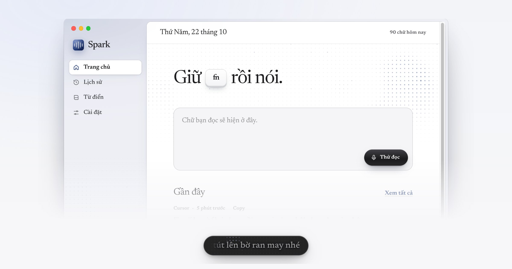

# Spark



Speech-to-text tiếng Việt cho dân code. Giữ **fn**, nói tiếng Việt lẫn từ tiếng Anh như lúc làm việc, thả ra là text đã cleanup được paste vào ô đang focus: Cursor, VS Code, Terminal, Slack, app nào cũng được.

**Hướng dẫn cài đặt: https://vuongnm.github.io/spark/**

```bash
curl -fsSL https://vuongnm.github.io/spark/install.sh | bash
```

Chạy trên Mac Apple Silicon. Mỗi release có kèm bản Windows (giữ Right Ctrl để nói), hiện vẫn là beta.

Lần đầu mở, Spark có một hướng dẫn ngắn: thiết lập permission và model, giữ fn đọc thử ba câu mẫu, rồi vài mẹo nhỏ. Muốn xem lại thì vào Cài đặt → Chung.

## Kiến trúc

1. **STT.** Trong lúc bạn giữ phím, overlay window stream audio về main process. Cứ 300 ms, Spark decode lại 12 giây gần nhất bằng [Zipformer](https://github.com/k2-fsa/sherpa-onnx) tiếng Việt 30M params (sherpa-onnx, CPU), nên transcript hiện real-time. Hotwords giúp model viết đúng chính tả khoảng 30 từ tiếng Anh dân code hay dùng (commit, deploy, staging…) và các từ trong dictionary của bạn. Một model tiếng Anh nhỏ (Moonshine tiny) chạy song song để bắt những từ tiếng Anh mà model tiếng Việt không viết được.
2. **LLM cleanup.** Transcript được gửi cho Gemma 4 E2B chạy local (node-llama-cpp, Metal) hoặc Claude Haiku qua Anthropic API key của bạn. Prompt nằm ở [`src/main/prompt.ts`](src/main/prompt.ts). Spark bắt đầu cleanup ngay khi bạn ngừng nói và khi thả phím, nên thường chỉ khoảng 1 giây sau khi thả là có text.
3. **Guard.** `checkDivergence` và `unspokenNumbers` trong [`src/main/format.ts`](src/main/format.ts) loại output nào thêm từ hoặc đổi số. Khi đó Spark fallback sang Claude hoặc basic cleanup.
4. **Paste.** Spark copy text vào clipboard, gửi ⌘V (Ctrl+V), rồi restore clipboard cũ.

Audio không bao giờ rời khỏi máy. Khi dùng Claude, Spark chỉ gửi transcript (text) tới Anthropic API.

## Development

```bash
npm ci
npm run build:native   # fn-watcher (Swift, CGEventTap), cần Xcode Command Line Tools
npm run dev
npm test
```

Self-test chạy toàn bộ pipeline thật, không cần UI:

```bash
npx electron-vite build
npx electron . --selftest=a.wav,b.wav --cleanup=local --app=code
npx electron . --selftest-clean="phích cái bấc ở file index chấm ts"
```

Chụp screenshot từ demo data (không lộ history thật của bạn):

```bash
SPARK_DATA_DIR=/đường/dẫn/dữ-liệu-mẫu npx electron . --screenshots=/thư/mục/ảnh
```

## Release

```bash
bash scripts/release-mac.sh                      # typecheck, test, build, codesign, đóng zip + dmg vào dist/release
bash scripts/publish.sh "Release notes"          # tạo GitHub release v<version>; CI build rồi attach bản Windows
```

Bản Mac được sign bằng self-signed certificate (chưa notarize với Apple), nên các permission đã cấp (TCC) được giữ qua các lần update. File tải bằng `curl` không bị gắn quarantine attribute. File `.dmg` tải bằng browser thì cần bấm "Open Anyway" trong System Settings → Privacy & Security một lần.

## License

MIT
